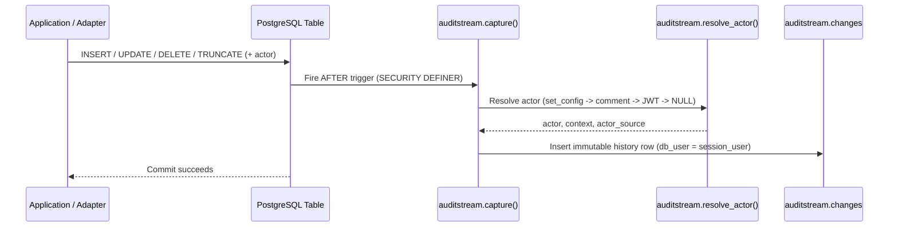

# How Capture Works

Auditstream captures database changes inside PostgreSQL using generated triggers and stores them in `auditstream.changes`.
Application code only supplies who acted.

## Capture flow

## Triggers

- **`INSERT` and `DELETE` run once per statement** using transition tables (`REFERENCING NEW TABLE` or `OLD TABLE`).
  The trigger resolves the actor once per statement instead of once per row.
- **`UPDATE` runs per row.** The capture function compares the JSONB row images after removing excluded columns.
  Equal images produce no history row. This also works for columns such as `json` that lack a PostgreSQL equality operator.
- **`TRUNCATE` runs once per statement** and records the table and actor with `NULL` row images.
- **Excluded columns** are removed from `before`, `after`, and `changed`.
- **Partitioned user tables** attach statement triggers to the parent table.
  Statements targeting a child partition directly bypass parent triggers, so `auditstream verify` warns about partitioned tables.

## Actor transport and precedence

`auditstream.resolve_actor()` resolves the actor in strict priority order:

1. **Transaction-local `set_config`:** `nullif(current_setting('auditstream.actor', true), '')` set inside the transaction.
2. **Trailing SQL comment:** the `auditstream` key inside the final comment of `right(current_query(), 4096)`.
3. **JWT claims:** the `sub` string inside `request.jwt.claims` (used by Supabase and PostgREST).
4. **No actor:** the history row is still written with `actor = NULL`, `actor_source = NULL`, and `db_user = session_user`.

A malformed payload never aborts the application's SQL write.
Instead, PostgreSQL stores `actor = NULL` and `actor_source = 'invalid'` and does not fall through to lower priorities.

### IDs only

Trailing SQL comments appear in `pg_stat_activity`, server logs, and the first query sample in `pg_stat_statements`.
Keep actor payloads to opaque identifiers only (`type`, `id`, optional `onBehalfOf`, and optional `tenant`).
Do not place names, emails, or personal data in actor fields unless your project explicitly accepts log exposure.

## Security model and bypasses

- The `auditstream` schema, `auditstream.changes`, all child partitions, `changes_id_seq`, and helper functions are owned by a dedicated `NOLOGIN` role (`auditstream_owner`).
- Trigger functions and `auditstream.log_event()` execute as `SECURITY DEFINER` with `SET search_path = pg_catalog, pg_temp` and schema-qualified names. `auditstream.capture()` also checks `pg_partition_ancestors(TG_RELID)` so triggers attached to unrelated tables cannot forge `source = 'db'` rows.
- Migrations and partition maintenance sanitize ACLs with `CASCADE` to neutralize permissive `ALTER DEFAULT PRIVILEGES` rules; application roles receive only `SELECT` on `auditstream.changes` and `EXECUTE` on `auditstream.log_event()`, with no direct write or `GRANT OPTION` privileges and no non-owner grants on child partitions or `changes_id_seq`.
- On managed PostgreSQL 16 and newer, migrations temporarily self-grant only the missing `INHERIT` / `SET` options on `auditstream_owner` inside the migration transaction, then revoke them before committing.

Triggers can still be bypassed by superusers or roles running `SET session_replication_role = replica`, or by disabling or dropping triggers.
Run [`auditstream verify`](../reference/cli/verify.md) in CI and on a schedule to detect missing, disabled, or outdated triggers, primary-key exclusions, unsafe privileges, and ownership drift.

## Write overhead

Measured on 2026-11-24 against PostgreSQL 19.0 and PgBouncer 1.26.1 ([full benchmark evidence](https://auditstream.dev/docs/evidence); see also [Evidence](../handbook/evidence.md)):

- **Durable disk (`fsync=on`, 16 clients):** single-row `UPDATE` adds **`+3.2%` (`+5.1 µs/row`)**, single-row `INSERT` measures **`−0.2%`** (within noise), and a 10,000-row bulk `INSERT` completes in **`60.5 ms` (`+3.8 µs/row`)**.
- **`tmpfs` ceiling:** statement-level bulk `INSERT` and `DELETE` sustain **`211k–213k rows/s`**, and excluded-column no-op updates sustain **`208k tps`** with **`0`** audit rows written.
- **Single-statement bulk `UPDATE` (~15k rows/s):** updating 10,000 rows in one SQL statement runs row-by-row (`665 ms`, `+64.5 µs/row`) by design because statement-level `UPDATE` transition tables split primary-key changes into two half-events and can mispair `OLD`/`NEW` rows across partitioned-table row movement ([ADR-0010](../decisions/0010-no-guc-actor-caching-in-capture-trigger.md)).
- **PgBouncer 1.26.1:** trailing SQL comments run **`1.8×–2.4×`** faster than transaction-local `set_config` under pooled concurrency (`2,407,659` pooled transactions at 8× oversubscription with `0` actor leaks).

## Bulk operations, wide-row trade-offs, and partition scaling

### Bulk `UPDATE`s and backfills: use `set_config`

Single-row pooled OLTP writes are faster with trailing SQL comments (no explicit transaction round-trip).
For large multi-row `UPDATE` statements or backfills, pass the actor with `SELECT pg_catalog.set_config('auditstream.actor', '<json>', true)` inside the transaction instead.
Because `auditstream_update` runs per row, `set_config` skips per-row SQL comment parsing and cuts 100,000-row bulk-`UPDATE` execution time by **~32%–40%** compared to comment triggers (`2.26–2.42 s` across PostgreSQL 15.20, 17.12, and 19.0 — vs. `3.34–3.64 s` with optimized plain-`TG_ARGV` comment triggers, and `~44%` below the `4.11–4.31 s` v0.1.0 baseline) with zero cache or spoofing trade-offs ([ADR-0010](../decisions/0010-no-guc-actor-caching-in-capture-trigger.md), [Set the actor without an adapter](../how-to/set-actor-without-adapter.md#when-to-prefer-set_config-bulk-updates-and-backfills)).
Behind AWS RDS Proxy, run large `set_config` backfills on a direct connection to avoid session pinning.

### Batch sizing for massive single-statement `INSERT` and `DELETE`

`auditstream_insert` and `auditstream_delete` run `FOR EACH STATEMENT` with PostgreSQL transition tables (`NEW TABLE` / `OLD TABLE`).
Large single-statement writes spill transition tuples sequentially to `pgsql_tmp` (`~N × row_width` bytes, avoiding OOM).
Verified on PostgreSQL 19.0: a 500,000-row single-statement `INSERT` completed in `2.84 s` and `DELETE` in `2.16 s`, spilling `~100 MB` to temp files.
On managed PostgreSQL instances with a strict `temp_file_limit`, batch bulk `INSERT` and `DELETE` statements to **`≤ 50,000–100,000` rows** per statement.

### Why `to_jsonb` (not `hstore` or `OLD.* IS DISTINCT FROM NEW.*`)

Auditstream builds row images and detects `UPDATE` diffs with `pg_catalog.to_jsonb(OLD)` and `pg_catalog.to_jsonb(NEW)` rather than `hstore` or a trigger `WHEN (OLD.* IS DISTINCT FROM NEW.*)` clause:

- **`DateStyle` integrity:** `to_jsonb` serializes `date`, `timestamp`, and `timestamptz` values canonically in ISO 8601 regardless of the caller's session `DateStyle`, whereas `hstore` casts values to session-dependent text strings.
- **Types without equality operators:** `WHEN (OLD.* IS DISTINCT FROM NEW.*)` fails on tables containing `json`, `xml`, or `point` columns that lack a PostgreSQL `=` operator, whereas `to_jsonb` succeeds cleanly.
- **Case-only `citext` changes:** `OLD IS DISTINCT FROM NEW` treats `'Alice'::citext` and `'alice'::citext` as equal and drops case-only edits, whereas `to_jsonb` compares JSON strings case-sensitively and records the change.

### Wide rows, HOT updates, and WAL amplification

- **User-table HOT updates preserved:** Auditstream adds no audit columns or indexes to audited tables, so PostgreSQL preserves Heap-Only Tuple (HOT) updates on user tables (verified live on PostgreSQL 17.12 on a 30-column table with `fillfactor = 80`: **84.2% HOT updates**).
- **Full-row snapshots and LZ4 TOAST compression:** In v0.1.x, `UPDATE` events store full `before` and `after` row images (minus `capture.exclude`). On PostgreSQL servers compiled with LZ4 support, Auditstream automatically enables `COMPRESSION lz4` on `changes.(before, after)` to reduce TOAST storage and CPU cost on wide rows ([History table reference: TOAST compression](../reference/history-table.md#toast-compression)).
- **WAL amplification on wide tables:** On 30-column single-column updates (PostgreSQL 17.12), full row images with `pglz` produce **`~1.83×` total WAL** (`243.6 MB -> 445.1 MB`, `+83%`). A planned v0.2 opt-in per-table `diff` storage mode (storing only changed keys in `before`/`after` with LZ4 compression, [#166](https://github.com/auditstream/auditstream/issues/166)) reduces total WAL on the same workload to **`~1.07×`** (`260.3 MB`, `+7%`).

### Partition scaling and constant `occurred_at` timestamps

Write-path `INSERT` routing into `auditstream.changes` stays flat (`~12k TPS`, `0.0%` `LWLock:LockManager`) up to 120 monthly partitions (10 years of retention).
On the read path, locking 120 partitions under 64 concurrent clients causes `LWLock:LockManager` contention unless PostgreSQL prunes partitions at **plan time**:

| Read query shape (120 monthly partitions, 64 clients) | PostgreSQL 17 | PostgreSQL 19 | `LWLock:LockManager` wait |
| --- | ---: | ---: | ---: |
| Unfiltered record lookup (`audit.history()`) | `~1.3k TPS` (`50×` drop from `65k`) | `~1.3k TPS` | `38%–44%` |
| `WHERE occurred_at >= now() - interval '90 days'` (`STABLE`) | `2,521 TPS` | `2,655 TPS` | `28%–37%` |
| **`WHERE occurred_at >= '<RFC3339>'::timestamptz` (constant)** | **`71,894 TPS`** | **`69,861 TPS`** | **`0.0%` (`26×–28.5×` faster)** |

Always pass application-computed constant RFC 3339 timestamps on time-bounded history queries so PostgreSQL prunes partitions before locking them.
To keep unfiltered lookups fast — especially on PostgreSQL 15–17 where per-backend fast-path lock slots cap at 16 — detach and drop old monthly partitions once every unfiltered export cursor **and its saved boundary `anchor` row** have advanced into a newer partition (automated commit-safe `auditstream prune` is planned for v0.2 in [#145](https://github.com/auditstream/auditstream/issues/145)). See [Isolate tenants with Row-Level Security (RLS)](../how-to/multi-tenant-rls.md#constant-timestamps-for-partition-pruning).

## Where Auditstream does not run

- **Aurora DSQL** does not support triggers and cannot run Auditstream v0.1.
- **CockroachDB** triggers are unproven with `current_query()` extraction and are unsupported.
- **Prisma Accelerate** does not expose raw SQL to client extensions; use the `set_config` transport inside transactions there.
- **AWS RDS Proxy** pins sessions when `set_config(..., true)` runs; use the trailing SQL comment transport behind RDS Proxy.

For supported PostgreSQL and Node.js versions, see [Releases: Supported versions](../handbook/releases.md#supported-versions).
