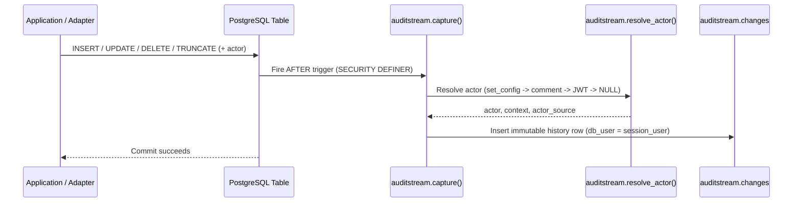

# How Capture Works

Auditstream captures database changes inside PostgreSQL using generated triggers and stores them in `auditstream.changes`.
Application code only supplies who acted.

## Capture flow

## Triggers

- **`INSERT` and `DELETE` run once per statement** using transition tables (`REFERENCING NEW TABLE` or `OLD TABLE`).
  The trigger resolves the actor once per statement instead of once per row.
- **`UPDATE` runs per row.** The capture function compares the JSONB row images after removing excluded columns.
  Equal images produce no history row. This also works for columns such as `json` that lack a PostgreSQL equality operator.
- **`TRUNCATE` runs once per statement** and records the table and actor with `NULL` row images.
- **Excluded columns** are removed from `before`, `after`, and `changed`.
- **Partitioned user tables** attach statement triggers to the parent table.
  Statements targeting a child partition directly bypass parent triggers, so `auditstream verify` warns about partitioned tables.

## Actor transport and precedence

`auditstream.resolve_actor()` resolves the actor in strict priority order:

1. **Transaction-local `set_config`:** `nullif(current_setting('auditstream.actor', true), '')` set inside the transaction.
2. **Trailing SQL comment:** the `auditstream` key inside the final comment of `right(current_query(), 4096)`.
3. **JWT claims:** the `sub` string inside `request.jwt.claims` (used by Supabase and PostgREST).
4. **No actor:** the history row is still written with `actor = NULL`, `actor_source = NULL`, and `db_user = session_user`.

A malformed payload never aborts the application's SQL write.
Instead, PostgreSQL stores `actor = NULL` and `actor_source = 'invalid'` and does not fall through to lower priorities.

### IDs only

Trailing SQL comments appear in `pg_stat_activity`, server logs, and the first query sample in `pg_stat_statements`.
Keep actor payloads to opaque identifiers only (`type`, `id`, optional `onBehalfOf`, and optional `tenant`).
Do not place names, emails, or personal data in actor fields unless your project explicitly accepts log exposure.

## Security model and bypasses

- The `auditstream` schema, `auditstream.changes`, and helper functions are owned by a dedicated `NOLOGIN` role (`auditstream_owner`).
- Trigger functions and `auditstream.log_event()` execute as `SECURITY DEFINER` with `SET search_path = pg_catalog, pg_temp` and schema-qualified names.
- Application roles receive `SELECT` on `auditstream.changes` and `EXECUTE` on `auditstream.log_event()`, with no direct write grants.
- On managed PostgreSQL 16 and newer, migrations self-grant `auditstream_owner` temporarily when `CREATEROLE` lacks `USAGE`, then revoke it.

Triggers can still be bypassed by superusers or roles running `SET session_replication_role = replica`, or by disabling or dropping triggers.
Run [`auditstream verify`](../reference/cli/verify.md) in CI and on a schedule to detect missing, disabled, or outdated triggers.

## Write overhead

Measured on 2026-11-24 against PostgreSQL 19.0 and PgBouncer 1.26.1 ([full benchmark evidence](https://auditstream.dev/docs/evidence); see also [Evidence](../handbook/evidence.md)):

- **Durable disk (`fsync=on`, 16 clients):** single-row `UPDATE` adds **`+3.2%` (`+5.1 µs/row`)**, single-row `INSERT` measures **`−0.2%`** (within noise), and a 10,000-row bulk `INSERT` completes in **`60.5 ms` (`+3.8 µs/row`)**.
- **`tmpfs` ceiling:** statement-level bulk `INSERT` and `DELETE` sustain **`211k–213k rows/s`**, and excluded-column no-op updates sustain **`208k tps`** with **`0`** audit rows written.
- **Single-statement bulk `UPDATE` (~15k rows/s):** updating 10,000 rows in one SQL statement runs row-by-row (`665 ms`, `+64.5 µs/row`) by design because statement-level `UPDATE` transition tables split primary-key changes into two half-events.
- **PgBouncer 1.26.1:** trailing SQL comments run **`1.8×–2.4×`** faster than transaction-local `set_config` under pooled concurrency (`2,407,659` pooled transactions at 8× oversubscription with `0` actor leaks).

## Where Auditstream does not run

- **Aurora DSQL** does not support triggers and cannot run Auditstream v0.1.
- **CockroachDB** triggers are unproven with `current_query()` extraction and are unsupported.
- **Prisma Accelerate** does not expose raw SQL to client extensions; use the `set_config` transport inside transactions there.
- **AWS RDS Proxy** pins sessions when `set_config(..., true)` runs; use the trailing SQL comment transport behind RDS Proxy.

For supported PostgreSQL and Node.js versions, see [Releases: Supported versions](../handbook/releases.md#supported-versions).
