# Security Model and Threat-Model Boundaries

Auditstream captures database changes inside PostgreSQL while keeping application roles read-only on audit history.
This page defines engine guarantees, operator responsibilities, and PostgreSQL or runtime limits.

For vulnerability reporting and supported versions, see [`SECURITY.md`](../../SECURITY.md).

## Trust zones and responsibility split

```mermaid
flowchart LR
    Client["Untrusted Client / Browser"]
    App["App Server and SDK (AsyncLocalStorage)"]
    Pool["Connection Pooler / Proxy"]
    PG["PostgreSQL Table and SECURITY DEFINER Trigger"]
    Owner["auditstream_owner (NOLOGIN) -> auditstream.changes"]
    CLI["auditstream CLI (verify / history / export)"]
    Archive["External WORM Archive (Operator / Future S3)"]

    Client -->|"Unverified headers / requests"| App
    App -->|"Self-asserted actor (comment or set_config)"| Pool
    Pool -->|"Authenticated db_user"| PG
    PG -->|"Append-only write"| Owner
    Owner -->|"Read-only SELECT"| CLI
    CLI -->|"JSONL / CSV"| Archive
```

Auditstream protects capture integrity against compromised application roles.
It does not replace host hardening, application authentication, or external immutable storage.

| Area | Engine guarantees (in scope) | Operator responsibilities | Database / runtime limits |
| --- | --- | --- | --- |
| History immutability | Dedicated `NOLOGIN` owner (`auditstream_owner`); application roles hold no write or `GRANT OPTION` privileges on `auditstream.changes` | Restrict `SUPERUSER`, `CREATEROLE`, and `auditstream_owner` membership; export incrementally to external WORM storage | Superusers, `auditstream_owner` admins, and OS root can disable triggers or mutate partitions |
| Capture integrity | `SECURITY DEFINER` functions with pinned `search_path`, revoked `capture()` `EXECUTE`, partition-ancestor validation, and stateless actor parsing | Run `auditstream verify` in CI and on a schedule; avoid direct writes to child partitions of audited user tables | Direct child-partition writes, DDL (`DROP TABLE`, `DETACH PARTITION`, `ALTER TABLE`), and `session_replication_role = replica` bypass triggers |
| Actor attribution | Strict precedence (`set_config` > trailing SQL comment > JWT `sub`); malformed payloads never abort SQL writes (`actor_source = 'invalid'`) | Authenticate users server-side, strip untrusted proxy headers, keep actors to opaque IDs only, and bound context inside 512 bytes | Only `db_user` (`session_user`) is PostgreSQL-authenticated; actors are application assertions |
| Tenant isolation | `--tenant` and `audit.query()` `tenant` filter; `verify` RLS checks; fail-closed `export` RLS guard | Enforce authorization server-side; project BFF DTOs; enable PostgreSQL RLS with dedicated `auditstream_verify` / `auditstream_exporter` roles when needed | `--tenant` filters self-asserted metadata and omits `actor IS NULL`, `'invalid'`, and `'jwt'` rows |
| Secrets and PII | `capture.exclude` drops columns before insert; `[[export.redaction.rules]]` masks or removes top-level keys in `export` and `history` (fail-closed exit `5`) | Put credentials, tokens, and PANs in `capture.exclude`; use surrogate PKs and opaque `target` IDs | v0.1 redaction covers top-level `before`/`after` keys only; `record_id` and nested JSONB paths are untouched |
| CLI and exports | TLS `verify-full` warnings, URL secret redaction, terminal sanitization, Unix `0600` + `O_NOFOLLOW`, SHA-256 setup verification | Use `sslmode=verify-full` on non-loopback hosts; target a single primary or standby; import CSV as plain text or use JSONL | CSV does not escape leading `=`, `+`, `-`, `@` to preserve forensic fidelity; heterogeneous multi-replica LBs break cursor checks |

## In-scope engine guarantees

### Append-only privilege separation and ownership

Auditstream isolates audit storage behind a dedicated `NOLOGIN` role (`auditstream_owner`).

- **Dedicated ownership:** `auditstream_owner` owns the audit schema, `auditstream.changes`, all child partitions (`changes_YYYY_MM` and `changes_default`), `changes_id_seq`, and helper functions.
- **Least-privilege application roles:** Application roles receive only `USAGE` on the audit schema, `SELECT` on `auditstream.changes`, and `EXECUTE` on `auditstream.log_event()`.
  They receive no `INSERT`, `UPDATE`, `DELETE`, `TRUNCATE`, or `GRANT OPTION` privileges.
  They also receive no non-owner grants on child partitions or `changes_id_seq`.
  `EXECUTE` on `auditstream.capture()` and `auditstream.resolve_actor()` is revoked from `PUBLIC` and all non-owner roles.
  Non-owners with `TRIGGER` privilege or table ownership therefore cannot attach `capture()` to arbitrary tables.
- **Read-only operations roles:** CI verification and export pipelines can use read-only roles (`auditstream_verify`, `auditstream_exporter`) with `USAGE` and `SELECT` only.
  These roles do not need `EXECUTE` on `auditstream.log_event()`.
- **Default-privilege neutralization:** Migrations and partition maintenance revoke unexpected `PUBLIC` and non-owner grants with `CASCADE`.
  This neutralizes permissive `ALTER DEFAULT PRIVILEGES` rules on newly created partitions.
- **Managed PostgreSQL 16+ safety:** When creating `auditstream_owner`, migrations clear `createrole_self_grant` locally inside the transaction.
  If a non-superuser `CREATEROLE` migrator lacks `SET` on `auditstream_owner`, migrations temporarily acquire only `SET` (`INHERIT FALSE, SET TRUE`).
  Auditstream never grants `INHERIT` on `auditstream_owner`, and revokes that temporary `SET` grant before committing.

### Trigger and function isolation

- **Hardened `SECURITY DEFINER`:** `auditstream.capture()`, `auditstream.resolve_actor()`, and `auditstream.log_event()` run as `SECURITY DEFINER`.
  Each pins `SET search_path = pg_catalog, pg_temp` and uses schema-qualified calls to prevent search-path hijacking.
- **Anti-forgery partition check:** As defense-in-depth at trigger execution time, explicit parent-table arguments (`TG_NARGS >= 4`) trigger a partition-ancestor check.
  `auditstream.capture()` verifies `TG_RELID` against `pg_catalog.pg_partition_ancestors(TG_RELID)` and raises `SQLSTATE 42501` if unrelated.
  An unrelated trigger cannot spoof `source = 'db'` rows attributed to another table.
- **Stateless actor resolution:** Per [ADR-0010](../decisions/0010-no-guc-actor-caching-in-capture-trigger.md), `capture()` never caches parsed actors in custom PostgreSQL placeholder GUCs.
  Custom GUCs are `PGC_USERSET`, so any application session could poison a cache to abort writes, bypass validation, or leak state across PgBouncer.

### Continuous drift, privilege, and RLS verification

[`auditstream verify`](../reference/cli/verify.md) inspects live PostgreSQL catalogs inside a `READ ONLY` transaction and reports 14 finding kinds:

- **Capture integrity:** `missing`, `disabled`, `outdated`, `invalid_exclusion`, `default_partition_rows`, `insufficient_partitions`, and advisory `partitioned_table`.
- **Privilege and tamper detection:** `unsafe_privileges`, `invalid_ownership`, and `tampered_history`.
  `unsafe_privileges` detects unexpected grants, unsafe `auditstream_owner` attributes, recursive PostgreSQL 16+ `ADMIN` memberships, and `session_replication_role = replica` overrides or non-superuser grants.
  `tampered_history` detects unexpected triggers (including internal RI triggers), rewrite rules, child-partition RLS policies, and unexpected helper overloads.
- **Row-Level Security hygiene:** `forced_rls` and `rls_without_select_policy` are `error` findings.
  `forced_rls` catches `FORCE ROW LEVEL SECURITY`, which breaks `auditstream_owner` trigger writes and partition maintenance.
  `rls_hides_default_partition` and `rls_bypassed_by_app_role` are `warning` findings.
  Pass `--app-role` (or configure `capture.app_roles`) to check application roles for RLS bypasses.

Use `--fail-on error` (default) for errors, or `--fail-on warning` in CI to fail on RLS and partitioned-table warnings too.

[`auditstream export`](../reference/cli/export.md) adds fail-closed guards before writing or advancing any cursor:

- **RLS completeness guard (exit `3`):** Before reading, export checks `pg_catalog.row_security_active` on `<schema>.changes`.
  If RLS is active, export fails closed unless an applicable `PERMISSIVE` `SELECT` policy uses `USING (true)` and no `RESTRICTIVE` `SELECT` policy narrows it.
  Intentional per-tenant exports must pass `--allow-rls-filtered`, which is stored in the cursor.
  Mixing filtered and unfiltered cursors fails with exit code `2`.
- **Snapshot window and continuity checks:** Per [ADR-0005](../decisions/0005-export-with-an-xid8-snapshot-window-cursor.md), `auditstream export` provides at-least-once delivery across committed `xid8` snapshot windows (`pg_snapshot_xmin()`).
  Each record carries a stable `event_id` UUID so downstream consumers can deduplicate retries.
  On resume, [`auditstream export`](../reference/cli/export.md#checkpoints-and-delivery) verifies server-side PostgreSQL identity (exit `2` on mismatch).
  It also checks `pg_snapshot_xmin()`, `timeline_id` non-regression, and boundary row anchors (exit `3` on standby lag, PITR rollback, or failover loss).

### Secret exclusion vs. post-capture minimization

Auditstream separates **capture-time exclusion** from **read/export-time redaction**:

- **Never store secrets (`capture.exclude`):** Put password hashes, API keys, OAuth secrets, session tokens, and payment card numbers (PAN/CVV) in `capture.exclude`.
  `auditstream.capture()` strips excluded columns before writing to `auditstream.changes`.
  Primary key columns cannot be excluded (`auditstream verify` reports `invalid_exclusion`).
- **Minimize PII on read and export (`[[export.redaction.rules]]`):** Rules mask (`"[redacted]"`) or remove matching top-level keys in `before` and `after`.
  `mode = "remove"` also removes matching names from `changed`.
  Both [`auditstream export`](../reference/cli/export.md#export-time-redaction) and [`auditstream history`](../reference/cli/history.md#redaction-and-payload-omission) apply configured rules automatically.
  - `auditstream history` adds `--redact` (exit `2` if no rules are loaded), `--unredacted` (break-glass opt-out), and `--omit-payload` (nullify `before` and `after`).
  - Both commands fail closed with exit code `5` if a matching rule hits a non-object or malformed JSON payload.
    `auditstream history` aborts before writing anything to stdout.
    `auditstream export` aborts before writing the failing batch (to stdout or `--output`) or advancing the cursor past the last flushed batch.
  - **v0.1 scope limit:** Rules match top-level `before`/`after` keys only, and `record_id` is never redacted.
    Use surrogate primary keys and opaque `log_event()` `target` identifiers when outputs must exclude PII.
    Nested JSONB path redaction and `record_id` redaction or HMAC pseudonymization are planned for v0.3.

### CLI transport, terminal, and filesystem hardening

- **TLS guidance and enforcement:** Connecting to a non-loopback TCP host (including `hostaddr` overrides) with `sslmode` weaker than `verify-full` emits a stderr warning.
  Always configure `sslmode=verify-full` in production.
  Rust callers using `auditstream-pg` directly can pass `ConnectOptions::require_verify_full()` (or `ConnectOptions::with_tls_policy(TlsPolicy::RequireVerifyFull)`) to `connect_with_options()`.
  That strict policy rejects weaker remote TLS modes outright.
- **Credential redaction in logs and errors:** Connection URLs mask userinfo passwords plus `password`, `sslpassword`, `ssl-password`, and `oauth_client_secret` parameters in errors and diagnostics.
  The CLI sets `sqlx_postgres::options=error` by default, even under `-v`/`-vv` or general `AUDITSTREAM_LOG=trace`.
  That filter suppresses connection-option dumps unless `AUDITSTREAM_LOG` explicitly targets `sqlx_postgres::options`.
- **Terminal escape neutralization:** `history` (`--format table` and `--diff`), `status`, `verify`, and error lines sanitize untrusted text before terminal display.
  Sanitization strips 7-bit and 8-bit ANSI CSI/OSC/DCS/SOS/PM/APC/ESC sequences, C0/C1 controls, and Unicode BiDi overrides (`U+202A`–`U+202E`, `U+2066`–`U+2069`).
  It also maps `\n`, `\r`, `\t`, `U+2028`, and `U+2029` to spaces.
- **Unix filesystem hardening:** Newly created `--output` files, atomic `--cursor-file` replacements, `<cursor-file>.lock` sidecars, and atomic `auditstream init` updates to `auditstream.toml` use mode `0600` on Unix.
  Pre-existing looser lock files are tightened to `0600`; pre-existing output files keep their permissions.
  On Unix, `--cursor-file`, `<cursor-file>.lock`, and `auditstream init` config targets reject symlinks (`O_NOFOLLOW`) and all non-regular files.
  `--output` rejects symlinks (`O_NOFOLLOW`), directories, FIFOs, sockets, and block devices.
  `--output` permits regular files and character devices (such as `/dev/null`).
- **CI binary verification:** `auditstream/auditstream/actions/setup` installs a pinned CLI release binary with SHA-256 verification.

## Explicit trust boundaries and architectural limits

These limits come from PostgreSQL semantics, network proxies, or application runtimes.
Engine and SDK code alone cannot remove them; operators must mitigate them in infrastructure and application code.

### 1. Superuser, database host, and OS root compromise

PostgreSQL superusers, members of `auditstream_owner`, and OS root on the database host can bypass every in-database control.
They can set `session_replication_role = replica`, drop triggers, rewrite historical partitions, or alter server binaries.

- **Why Auditstream does not seal partitions in-database:** Per [ADR-0009](../decisions/0009-no-ui-package-or-in-db-partition-sealing.md), same-database hash chains or partition seals share the superuser's trust domain.
  They also serialize hot-path writes, race with `clock_timestamp()` month boundaries, and break monthly retention drops (`DROP TABLE`).
- **Required mitigations:**
  - Restrict `SUPERUSER`, `CREATEROLE`, and `auditstream_owner` membership strictly to break-glass administration and CI migrations.
  - Run `auditstream verify` on a schedule to detect privilege, ownership, or trigger tampering.
  - Export events incrementally to external write-once storage (such as S3 Object Lock Compliance Mode) under a separate administrative boundary.
    Native WORM object-storage sinks and externally signed SHA-256 export manifests are planned post-v0.1 (`#112`).

### 2. Application-asserted actor identity vs. PostgreSQL `db_user`

Only `db_user` (`session_user`) is authenticated by PostgreSQL.
Every actor transport — transaction-local `set_config`, trailing SQL comments, and `request.jwt.claims` — carries an application or gateway assertion.
A compromised application server with valid database credentials can emit any schema-valid actor JSON.

- **Required mitigations:**
  - Derive `actor` strictly from server-verified sessions, API keys, or verified JWTs — never from client bodies or unverified headers.
  - Strip or overwrite spoofable proxy headers (`x-forwarded-for`, `x-request-id`, and custom identity headers) at your trusted edge or reverse proxy.
  - Bound client-controlled `context` fields (`requestId`, and opt-in `ip` or `userAgent`) within the 512-byte budget in [`spec/actor.md`](../../spec/actor.md#size-limit).
    Normative SDK encoders (including `@auditstream/node`) reject payloads over 512 UTF-8 bytes before sending SQL by throwing `AuditstreamError("PAYLOAD_TOO_LARGE")`.
    Passing unbounded headers directly into the SDK therefore lets untrusted clients trigger request errors (application DoS).
    By contrast, PostgreSQL trigger readers receiving unvalidated raw SQL, `set_config`, or JWT claims never abort writes; they record `actor = NULL` and `actor_source = 'invalid'`.
  - Follow the **IDs-only privacy rule** ([`spec/actor.md`](../../spec/actor.md#privacy-rule-ids-only)): trailing SQL comments appear in `pg_stat_activity`, server logs, and `pg_stat_statements`.
    Store opaque IDs (`user:usr_42`), not names, emails, or personal data, in `actor`.

### 3. `actor.tenant` filtering vs. authorization and RLS

`auditstream history --tenant`, `auditstream export --tenant`, and `audit.query(exec, { tenant, ... })` filter self-asserted `actor.tenant` and `actor.onBehalfOf.tenant` metadata.

- **Completeness caveat:** Tenant filters omit rows where `actor` is `NULL` (migrations, cron jobs, direct DBA writes) or `actor_source = 'invalid'`.
  They also omit `actor_source = 'jwt'` rows because JWT fallback populates only `type` and `id`.
- **Authorization caveat:** Metadata filtering is never a substitute for application authorization or database-level tenant isolation.
- **Required mitigations:**
  - Authorize every audit query on the server before reading `auditstream.changes`.
  - Follow the Backend-for-Frontend (BFF) pattern in [ADR-0009](../decisions/0009-no-ui-package-or-in-db-partition-sealing.md): project an allowlisted DTO on the server.
    Never return raw `auditstream.changes` rows (`db_user`, `xact_id`, `table_oid`, full row images) to browsers.
  - When database-level multi-tenant isolation is required, enable Row-Level Security on `auditstream.changes` (never `FORCE ROW LEVEL SECURITY`).
  - Scope tenant `PERMISSIVE` policies to the application role rather than `PUBLIC`.
  - Use dedicated `auditstream_verify` and `auditstream_exporter` roles with unobstructed `PERMISSIVE USING (true)` policies.
    Run `auditstream verify --fail-on warning --app-role <app_role>` to catch RLS bypasses and hidden `changes_default` rows.

### 4. PostgreSQL DML trigger boundaries

Auditstream captures changes through PostgreSQL `AFTER` DML triggers ([ADR-0002](../decisions/0002-capture-changes-with-generated-triggers.md)).
Several PostgreSQL and distributed-SQL behaviors sit outside trigger execution:

- **Partitioned user tables:** `INSERT`, `DELETE`, and `TRUNCATE` statement triggers attach to the partitioned parent table.
  Writes targeting a child partition directly bypass parent statement triggers.
  `auditstream verify` flags partitioned audited tables with a `partitioned_table` warning; route writes through the parent table.
- **DDL operations:** Schema and table DDL — including `DROP TABLE`, `DETACH PARTITION`, and `ALTER TABLE` — does not fire DML triggers.
  `TRUNCATE` on an audited table is captured by its dedicated statement trigger, but dropping or detaching tables is not.
- **Replication role bypass:** Sessions running `SET session_replication_role = replica` skip origin (`'O'`) triggers.
  `auditstream verify` flags `replica` overrides and non-superuser `session_replication_role` grants as `unsafe_privileges`.
- **Unsupported engines:** Aurora DSQL (no triggers) and CockroachDB (unproven `current_query()` extraction) are unsupported.

### 5. Connection poolers, proxies, multi-statement batches, and read replicas

- **Transaction-mode poolers (`is_local = true` mandatory):** Behind PgBouncer, Supavisor, or Neon pooler, pass `true` to `set_config('auditstream.actor', '<json>', true)` inside an explicit transaction.
  Session-scoped `set_config(..., false)` or `SET` persists on the pooled backend connection and leaks actors across unrelated requests and tenants.
- **Named prepared statements:** Never combine named prepared statements (`node-postgres` `name` or `postgres.js` prepared statements) with per-actor SQL comments ([`spec/transport.md`](../../spec/transport.md#named-prepared-statements-prohibition)).
  Distinct comments create unbounded server-side prepared-statement cache entries.
  `wrapPgPool` and `wrapPostgresJs` strip `name` and force `prepare: false` on queries they tag themselves (pre-tagged queries keep caller options).
  Use transaction-local `set_config` if you need named prepared statements.
- **Multi-statement SQL batches (`;`):** `current_query()` returns the full client-submitted batch string.
  `auditstream.resolve_actor()` inspects only the final trailing comment inside `right(current_query(), 4096)`.
  All statements in one semicolon-separated batch therefore share that final trailing comment.
  Earlier inline comments are ignored, and comments outside the final 4,096 characters are missed.
- **Proxy-specific transport limits:**
  - **Prisma Accelerate:** Under Accelerate, SQL commenter plugins do not receive rendered SQL and comment delivery to PostgreSQL is unproven.
    Use `auditTransaction()` from `@auditstream/prisma` (transaction-local `set_config`).
  - **AWS RDS Proxy:** Running `set_config(..., true)` pins server sessions; use the trailing SQL comment transport behind RDS Proxy.
- **Read-replica load balancers and `auditstream export`:** `auditstream export` acquires pooled connections separately for identity checks, RLS validation, resume continuity checks, snapshot-window reads, and lag checks.
  Default unfiltered batch reads run in short `READ COMMITTED, READ ONLY` transactions.
  `--allow-rls-filtered` batches run in autocommit, and lag checks run in `REPEATABLE READ, READ ONLY`.
  Target a single primary or a single standby — never a heterogeneous multi-replica load balancer.
  Standby replication lag, backward `timeline_id` regressions, or divergent anchors fail closed with exit code `3`.

### 6. CSV forensic fidelity vs. spreadsheet formula injection

Per [`spec/export.md`](../../spec/export.md#csv-encoding), `auditstream export --format csv` **does not** prefix or mutate cells beginning with `=`, `+`, `-`, or `@`.
Altering cell text would corrupt the forensic audit record and break diff or checksum fidelity.

- **Required mitigations:**
  - Prefer `--format jsonl` for pipelines, SIEM ingestion, and archival storage.
  - When opening exported CSV files in spreadsheet tools (Excel, LibreOffice Calc, Google Sheets), import columns as plain text rather than evaluating formulas.

### 7. Node.js and TypeScript runtime escape hatches

The TypeScript SDK (`@auditstream/node`, `@auditstream/prisma`, `@auditstream/drizzle`) propagates actor context via Node.js `AsyncLocalStorage` and tags SQL at specific driver entry points.
Several runtime patterns bypass tagging or drop context silently (recording `actor = NULL` while PostgreSQL triggers still capture the row change):

- **Driver tagged templates:** `wrapPostgresJs` (`postgres.js`) and `wrapNeonHttp` (`@neondatabase/serverless`) pass tagged templates (`` sql`...` ``) through untouched because those drivers assemble SQL internally.
  Only `postgres.js` `.unsafe()` and Neon HTTP `sql.query()` or plain string `sql(text, ...)` — the paths Drizzle uses — receive comment tags.
  For raw tagged templates, use transaction-local `set_config` or switch to the tagged entry points.
- **`node-postgres` submittables:** `wrapPgPool` passes submittable objects with a `.submit()` method (such as `pg-cursor` and `pg-query-stream`) through untouched without comment tagging.
- **Lazy or unawaited queries:** Building a lazy ORM query or thenable inside `audit.as()` and awaiting it after `audit.as()` returns runs outside the `AsyncLocalStorage` scope, recording `actor = NULL`.
  Always `await` queries inside the `audit.as()` callback.
- **Next.js `proxy` boundary:** Next.js `proxy` executes outside Route Handler and Server Action async contexts and cannot propagate `AsyncLocalStorage` into them.
  Wrap Route Handlers with `withAudit()` and Server Actions with `auditAction()` from `@auditstream/node/next`, and strip untrusted inbound headers first.
- **Broken async context and background jobs:** Callback-based libraries that break `AsyncLocalStorage`, detached timers, and queue workers lose ambient actor context.
  Open a fresh `audit.as()` scope (for example with a `service` or `system` actor) inside each worker or callback.

## Operator security checklist

Use this checklist for production hardening and compliance reviews (SOC 2, ISO/IEC 27001, PCI-DSS):

- [ ] Provision separate least-privilege PostgreSQL roles (`app_user`, `auditstream_verify`, `auditstream_exporter`) and restrict `SUPERUSER`, `CREATEROLE`, and `auditstream_owner`.
- [ ] Enforce `sslmode=verify-full` on all non-loopback PostgreSQL connections for apps, CI verification, and exports.
- [ ] Add every secret column (password hashes, tokens, API keys, PAN/CVV) to `capture.exclude` before enabling triggers.
- [ ] Configure `[[export.redaction.rules]]` for PII minimization in `export` and `history`, pass `--redact` in scripted or agent wrappers, and prefer surrogate primary keys and opaque `target` IDs.
- [ ] Run `auditstream verify` in CI (via pinned `auditstream/auditstream/actions/setup`) and on a schedule.
  When RLS is enabled, pass `--fail-on warning` and `--app-role` (or configure `capture.app_roles`).
- [ ] Export incrementally to external WORM storage (such as S3 Object Lock) on a schedule from a single primary or standby endpoint.
- [ ] Derive actors server-side, strip spoofable edge headers, and keep actor payloads to opaque IDs only.
  Project BFF DTOs on the server instead of returning raw `auditstream.changes` rows to browsers.

## Related documentation

- [Security Policy (`SECURITY.md`)](../../SECURITY.md)
- [How capture works](how-capture-works.md)
- [Actor and Context Schema (`spec/actor.md`)](../../spec/actor.md)
- [Actor Transport and Precedence (`spec/transport.md`)](../../spec/transport.md)
- [History Table and Functions Contract (`spec/history-table.md`)](../../spec/history-table.md)
- [Export Record Format (`spec/export.md`)](../../spec/export.md)
- [ADR-0002: Capture changes with generated triggers](../decisions/0002-capture-changes-with-generated-triggers.md)
- [ADR-0003: Carry the actor in a trailing SQL comment](../decisions/0003-carry-the-actor-in-a-trailing-sql-comment.md)
- [ADR-0005: Export with an `xid8` snapshot-window cursor](../decisions/0005-export-with-an-xid8-snapshot-window-cursor.md)
- [ADR-0008: History table lookup index shape](../decisions/0008-history-lookup-index.md)
- [ADR-0009: No official React UI package or in-DB partition sealing](../decisions/0009-no-ui-package-or-in-db-partition-sealing.md)
- [ADR-0010: No GUC actor caching or statement-level `AFTER UPDATE`](../decisions/0010-no-guc-actor-caching-in-capture-trigger.md)
- [`auditstream verify` CLI reference](../reference/cli/verify.md)
- [`auditstream export` CLI reference](../reference/cli/export.md)
- [`auditstream history` CLI reference](../reference/cli/history.md)
- [Configuration reference](../reference/config.md)
- [Check triggers in CI with `verify`](../how-to/verify-in-ci.md)
- [Run on Neon or Supabase](../how-to/run-on-neon-and-supabase.md)
