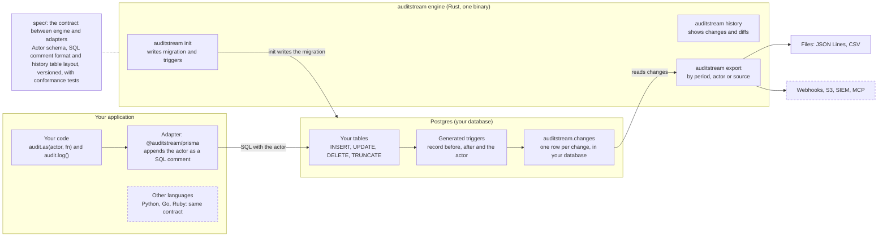

# Auditstream Engineering Handbook

Nov 23, 2026 · @Gabriel Lobo

Auditstream is built by several people and AI agents in parallel, so this handbook fixes the architecture and the working rules everyone follows. It is reviewed here first, then split into files in the auditstream and auditstream-js repositories.

Every load-bearing claim was re-checked on 2026-11-24, by experiment on PostgreSQL 16, Prisma 7.10 and Drizzle, or against its primary source. What was tested and what changed is in [Evidence](evidence.md).

## At a glance

**The Rust engine captures and exports; adapters only tell Postgres who acted.** Solid borders ship in v0.1. Dashed borders come later.

Application code never writes audit rows itself. The adapter attaches the actor to each statement, the generated triggers record the change in the same database, and the Rust CLI reads and exports it.

## Contents

| File | Summary |
| --- | --- |
| [README.md](README.md) | Overview, architecture diagram, file index and sources |
| [repositories.md](repositories.md) | Repository split and ownership rules |
| [engine-architecture.md](engine-architecture.md) | Rust Cargo workspace, ports, data flow and crate choices |
| [capture-design.md](capture-design.md) | Trigger capture, actor resolution, history table, security and trade-offs |
| [contract.md](contract.md) | Normative `spec/` layout, actor schema, transport and conformance |
| [adapters.md](adapters.md) | TypeScript packages, runtime support and adapter rules |
| [engineering-standards.md](engineering-standards.md) | Toolchains, quality gates, testing strategy and CI workflows |
| [releases.md](releases.md) | Engine, adapter and spec release pipelines and supported versions |
| [documentation.md](documentation.md) | ADRs, specs, RFCs, Diátaxis guide and writing rules |
| [workflow.md](workflow.md) | Issues, labels, branches, commits, pull requests and merge rules |
| [parallel-work.md](parallel-work.md) | Rules for conflict-free parallel work across humans and agents |
| [ai-policy.md](ai-policy.md) | Accountability, AI disclosure, limits and `AGENTS.md` rules |
| [security-and-community.md](security-and-community.md) | License, security policy, code of conduct and launch files |
| [roadmap-v0.1.md](roadmap-v0.1.md) | Five-wave v0.1 backlog, epic links and open decisions |
| [evidence.md](evidence.md) | Experiments and primary-source checks backing the handbook |
| [test-kit/README.md](test-kit/README.md) | Field-tested SQL and TypeScript prototype behind the evidence |

## Sources

Research for this handbook ran in November 2026; versions and dates come from the npm, crates.io and GitHub release records.

**Capture and transport**

- [Prisma: SQL comments](https://www.prisma.io/docs/orm/prisma-client/observability-and-logging/sql-comments) and [changelog for 7.1](https://www.prisma.io/changelog/2025-12-03)
- [Drizzle: SQL comments](https://orm.drizzle.team/docs/sql-comments) and [issue 2147](https://github.com/drizzle-team/drizzle-orm/issues/2147)
- [sqlcommenter specification](https://google.github.io/sqlcommenter/spec/)
- [PostgreSQL: trigger functions in PL/pgSQL](https://www.postgresql.org/docs/current/plpgsql-trigger.html), [CREATE TRIGGER](https://www.postgresql.org/docs/current/sql-createtrigger.html), [table partitioning](https://www.postgresql.org/docs/current/ddl-partitioning.html), [system information functions](https://www.postgresql.org/docs/current/functions-info.html), [lexical structure](https://www.postgresql.org/docs/current/sql-syntax-lexical.html#SQL-SYNTAX-COMMENTS), [pg\_stat\_statements](https://www.postgresql.org/docs/current/pgstatstatements.html)
- [PgBouncer features](https://www.pgbouncer.org/features.html) and [RDS Proxy pinning](https://docs.aws.amazon.com/AmazonRDS/latest/UserGuide/rds-proxy-pinning.html)
- [Logical streaming replication protocol](https://www.postgresql.org/docs/current/protocol-logical-replication.html), [REPLICA IDENTITY](https://www.postgresql.org/docs/current/sql-altertable.html#SQL-ALTERTABLE-REPLICA-IDENTITY), [max\_slot\_wal\_keep\_size](https://www.postgresql.org/docs/current/runtime-config-replication.html#GUC-MAX-SLOT-WAL-KEEP-SIZE) and [Postgres LISTEN/NOTIFY does not scale (Recall.ai)](https://recall.ai/blog/postgres-listen-notify-does-not-scale)
- [Node.js: AsyncLocalStorage troubleshooting](https://nodejs.org/api/async_context.html#troubleshooting-context-loss) and [Next.js proxy](https://nextjs.org/docs/app/api-reference/file-conventions/proxy)
- Prior art: [2ndQuadrant audit-trigger](https://github.com/2ndQuadrant/audit-trigger), [supa\_audit](https://github.com/supabase/supa_audit), [bemi-prisma](https://github.com/BemiHQ/bemi-prisma)

**Rust engine**

- [Large Rust workspaces (matklad)](https://matklad.github.io/2021/08/22/large-rust-workspaces.html), [uv workspace](https://raw.githubusercontent.com/astral-sh/uv/main/Cargo.toml), [Vector sinks](https://raw.githubusercontent.com/vectordotdev/vector/master/lib/vector-core/src/sink.rs)
- [Async fn in traits](https://blog.rust-lang.org/2023/12/21/async-fn-rpit-in-traits/), [sqlx changelog](https://raw.githubusercontent.com/launchbadge/sqlx/main/CHANGELOG.md), [cargo-deny bans](https://raw.githubusercontent.com/EmbarkStudios/cargo-deny/main/docs/src/checks/bans/cfg.md)
- [release-plz](https://release-plz.dev/docs), [release-plz tokens](https://release-plz.dev/docs/github/token), [dist custom jobs](https://axodotdev.github.io/cargo-dist/book/ci/customizing.html), [Cargo SemVer](https://doc.rust-lang.org/cargo/reference/semver.html)
- [supabase/etl](https://raw.githubusercontent.com/supabase/etl/main/README.md)

**TypeScript adapters**

- [pnpm 12](https://pnpm.io/blog/releases/12.0), [tsdown exports](https://tsdown.dev/options/package-exports), [tsup maintenance notice](https://github.com/egoist/tsup)
- [Dual package hazard](https://nodejs.org/api/packages.html#dual-package-hazard), [Node.js release schedule](https://raw.githubusercontent.com/nodejs/Release/main/schedule.json)
- [npm trusted publishers](https://docs.npmjs.com/trusted-publishers), [npm classic tokens revoked](https://github.blog/changelog/2025-12-09-npm-classic-tokens-revoked-session-based-auth-and-cli-token-management-now-available/)
- [Prisma shared extensions](https://www.prisma.io/docs/orm/prisma-client/client-extensions/shared-extensions), [better-auth package.json](https://raw.githubusercontent.com/better-auth/better-auth/HEAD/package.json)

**Collaboration and AI**

- [GitHub rulesets](https://docs.github.com/en/repositories/configuring-branches-and-merges-in-your-repository/managing-rulesets/about-rulesets), [plans](https://docs.github.com/en/get-started/learning-about-github/githubs-plans), [squash settings](https://docs.github.com/en/repositories/configuring-branches-and-merges-in-your-repository/configuring-pull-request-merges/configuring-commit-squashing-for-pull-requests)
- [Issue types](https://docs.github.com/en/issues/tracking-your-work-with-issues/using-issues/managing-issue-types), [issue fields](https://docs.github.com/en/issues/tracking-your-work-with-issues/using-issues/managing-issue-fields), [sub-issues](https://docs.github.com/en/issues/tracking-your-work-with-issues/using-issues/adding-sub-issues), [dependencies](https://docs.github.com/en/issues/tracking-your-work-with-issues/using-issues/creating-issue-dependencies)
- [Default community health files](https://docs.github.com/en/communities/setting-up-your-project-for-healthy-contributions/creating-a-default-community-health-file)
- [Conventional Commits 1.0](https://www.conventionalcommits.org/en/v1.0.0/), [MADR](https://adr.github.io/madr/), [Diátaxis](https://diataxis.fr/how-to-use-diataxis/), [OpenTelemetry spec versioning](https://github.com/open-telemetry/opentelemetry-specification#versioning-the-specification)
- [Google: small changes](https://google.github.io/eng-practices/review/developer/small-cls.html), [trunk-based development](https://trunkbaseddevelopment.com/short-lived-feature-branches/)
- [AGENTS.md](https://agents.md/), [Claude Code memory](https://code.claude.com/docs/en/memory), [Copilot coding agent: best results](https://docs.github.com/en/copilot/tutorials/coding-agent/get-the-best-results)
- AI policies: [Linux kernel](https://docs.kernel.org/process/coding-assistants.html), [LLVM](https://llvm.org/docs/AIToolPolicy.html), [Node.js](https://github.com/nodejs/node/blob/main/doc/contributing/ai-guidelines.md), [Ghostty](https://github.com/ghostty-org/ghostty/blob/main/AI_POLICY.md), [curl](https://github.com/curl/curl/blob/master/docs/CONTRIBUTE.md)
- [Contributor Covenant 3.0](https://www.contributor-covenant.org/version/3/0/code_of_conduct/), [private vulnerability reporting](https://docs.github.com/en/code-security/how-tos/report-and-fix-vulnerabilities/configure-vulnerability-reporting/configuring-private-vulnerability-reporting-for-a-repository)
