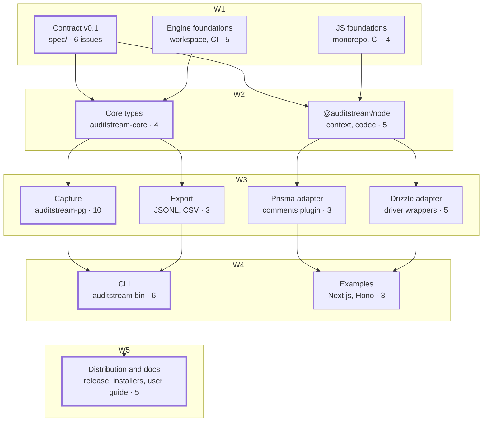

# v0.1 backlog

> **Status:** v0.1.0 shipped 2026-11-24 — preserved as historical planning record.

v0.1 is 59 issues in 12 epics, delivered in five waves; the contract is the one item that blocks both repositories.

**Five waves to v0.1; the contract gates both repositories.** Boxes are epics with their issue count. The critical path has a thick border.

Engine and JS foundations unblock everything after them. Wave 3 is the widest: capture, export and both adapters run in parallel, with up to four streams at once.

| Wave | Weeks | Epics | Exit criterion |
| --- | --- | --- | --- |
| W1 | 1 | Contract v0.1 (6), Engine foundations (5), JS foundations (4) | Spec 0.1.0 tagged with fixtures; both repositories build green in CI |
| W2 | 1 to 2 | Core types (4), @auditstream/node (5) | Codec passes conformance in Rust and TypeScript |
| W3 | 2 to 4 | Capture (10), Export (3), Prisma adapter (3), Drizzle adapter (5) | Every capture scenario passes on Postgres 15 to 19; both adapters pass their integration suites |
| W4 | 4 | CLI (6), Examples (3) | `init`, `history` and `export` work end to end on the example apps |
| W5 | 5 | Distribution and docs (5) | A tagged release installs with npm, Homebrew and the shell script |

The full issue list, with types, sizes, blockers and who may take each one, is in [Backlog v0.1](#epics), together with one issue written out in full as the format every issue follows.

Capacity: 59 issues of up to two days each is more than two people can finish in five weeks alone. The plan assumes agents take most `agent-ready` issues, as the [parallel work rules](parallel-work.md) describe.

## Epics

| Wave | Repository | Epic | Issues |
| --- | --- | --- | --- |
| W1 | `auditstream/auditstream` | [#1 Epic: Contract v0.1](https://github.com/auditstream/auditstream/issues/1) | 6 |
| W1 | `auditstream/auditstream` | [#2 Epic: Engine foundations](https://github.com/auditstream/auditstream/issues/2) | 5 |
| W1 | `auditstream/auditstream-js` | [#3 Epic: JS foundations](https://github.com/auditstream/auditstream-js/issues/3) | 4 |
| W2 | `auditstream/auditstream` | [#3 Epic: Core types](https://github.com/auditstream/auditstream/issues/3) | 4 |
| W2 | `auditstream/auditstream-js` | [#4 Epic: @auditstream/node](https://github.com/auditstream/auditstream-js/issues/4) | 5 |
| W3 | `auditstream/auditstream` | [#4 Epic: Capture](https://github.com/auditstream/auditstream/issues/4) | 10 |
| W3 | `auditstream/auditstream` | [#5 Epic: Export](https://github.com/auditstream/auditstream/issues/5) | 3 |
| W3 | `auditstream/auditstream-js` | [#5 Epic: Prisma adapter](https://github.com/auditstream/auditstream-js/issues/5) | 3 |
| W3 | `auditstream/auditstream-js` | [#6 Epic: Drizzle adapter](https://github.com/auditstream/auditstream-js/issues/6) | 5 |
| W4 | `auditstream/auditstream` | [#6 Epic: CLI](https://github.com/auditstream/auditstream/issues/6) | 6 |
| W4 | `auditstream/auditstream-js` | [#7 Epic: Examples](https://github.com/auditstream/auditstream-js/issues/7) | 3 |
| W5 | `auditstream/auditstream` | [#7 Epic: Distribution and docs](https://github.com/auditstream/auditstream/issues/7) | 5 |

## Open decisions

Six choices needed the team before the handbook moves into the repositories; each has a recommendation, and decided ones say so.

| Decision | Options | Recommendation | Needed by |
| --- | --- | --- | --- |
| GitHub plan while private | Team at $4 per user per month (rulesets, required reviews, CODEOWNERS, organization rulesets), or rules by agreement | Decided on 2026-11-24: GitHub Team, so rulesets enforce the rules from the first pull request; CODEOWNERS still waits for the public launch | Before the first pull request |
| AI disclosure | Required pull request field, or an `Assisted-by:` trailer on every commit | Decided on 2026-11-24: the required pull request field, as written in [the AI policy](ai-policy.md) | Before the first pull request |
| Security and conduct contact | An email on the future domain, or personal emails for now | Decided on 2026-11-24: auditstream.dev is registered; `security@auditstream.dev` and `conduct@auditstream.dev` forward to both maintainers | Before SECURITY.md lands |
| Oldest PostgreSQL supported | 15 or 16 | Decided on 2026-11-24: 15. It is supported upstream until 2027-11-11, and the test suite gives identical results on 15 through 19 | Before B4 |
| Scope of v0.1 | All 59 issues, or move D10, JD2, JD3, G3 and JE2 to v0.2 | Decide after W1 by measuring how many issues the first week closed | End of week 1 |
| Prisma 8 | Support at its stable release, or start now on the release candidate | Wait for the stable release; the release candidate has no SQL comment API | When Prisma 8 ships |
